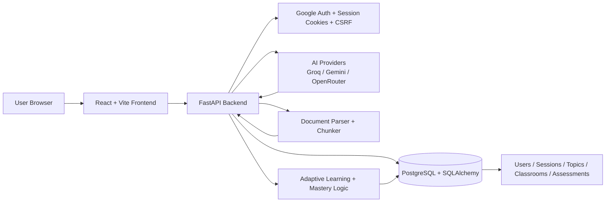
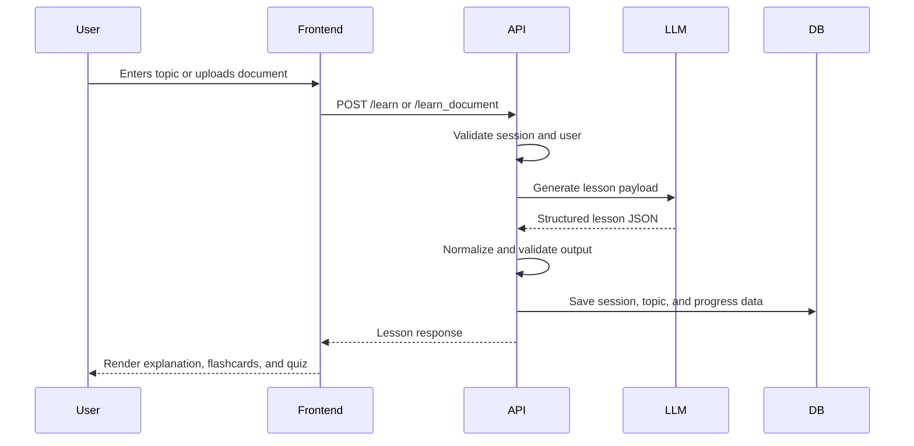

# Curiosity

Curiosity is an AI-powered learning platform designed around a learning loop: generate content, validate it, assess the learner, store progress, and recommend refinement.

## Architecture overview



## Core system design

### Frontend layer
- React + Vite app for the student and classroom experience
- Handles lesson generation, quizzes, flashcards, history, profile, and classroom views
- Calls the backend through a shared API client

### API layer
- FastAPI application in `backend/main.py`
- Owns auth, topic generation, retests, scoring, classroom workflows, and profile endpoints
- Validates payloads and enforces session ownership and role-based access

### AI orchestration layer
- Provider abstraction in `backend/llm.py`
- Converts model output into structured lesson data
- Normalizes and validates AI responses before storing or rendering them

### Data layer
- PostgreSQL is the system of record
- SQLAlchemy models in `backend/orm_models.py` define the schema
- DB session lifecycle is managed in `backend/database.py`
- A custom compatibility layer in `backend/persistence.py` preserves Mongo-like collection semantics over a relational storage model

### Learning intelligence layer
- Adaptive learning and revision logic in `backend/adaptive.py`
- Mastery and evidence aggregation in `backend/mastery.py`
- Tracks learner strengths and weaknesses to drive retests and revision tasks

### Document processing layer
- Upload and parse study documents before instruction generation
- Chunking and extraction are handled before the content is sent to the model

## Learning flow



## Technology stack

- Frontend: React, TypeScript, Vite
- Backend: Python, FastAPI, Pydantic, SQLAlchemy
- Database: PostgreSQL
- Auth: Google OAuth + server-side session cookies
- AI: Groq, Gemini, OpenRouter-compatible providers

## Repository structure

```text
backend/
  main.py
  llm.py
  models.py
  database.py
  orm_models.py
  persistence.py
  adaptive.py
  mastery.py
  document_processor/

frontend/
  src/
  package.json
  vite.config.ts
```

## Run locally

```bash
cd backend
python -m venv .venv
source .venv/bin/activate
pip install -r requirements.txt
uvicorn main:app --reload --host 0.0.0.0 --port 8000
```

```bash
cd frontend
npm install
npm run dev
```

## Why this architecture matters

This project is not just a chatbot. It is a system designed to turn AI-generated content into durable educational state. The architecture keeps the app reliable by separating:

- the user interface
- the API layer
- AI provider integration
- storage and relational state
- mastery and adaptive recommendation logic

That makes the platform behave like a learning system rather than a one-off prompt response.
